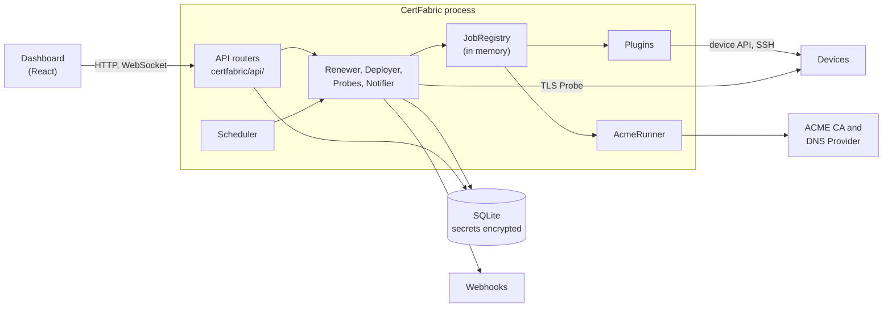
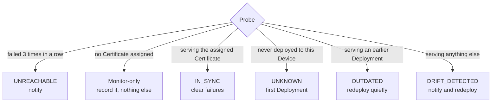

# Architecture

CertFabric is one Python process with a SQLite file beside it. It issues Certificates with `acme.sh`, pushes them to Devices through Plugins, and Probes each Device to check it is still serving what it should. There are no agents on Devices and no external services other than your CA, your DNS Provider and any webhooks you add.

This document is a map for working on the code. The words **Certificate**, **Device**, **Plugin**, **Probe**, **Deployment**, **Drift** and **Outdated** have exact meanings defined in [`GLOSSARY.md`](GLOSSARY.md). The reasons behind the main decisions are in [`docs/adr/`](docs/adr/). [`PRD.md`](PRD.md) is the original specification; where it and the code disagree, the code and the ADRs are right.

## Overview

`create_app` in `certfabric/app.py` builds everything and is the best place to start reading. The shared objects (vault, scheduler, jobs, Plugins, Deployer, Notifier, Renewer) live on `app.state`, and the core modules receive that state rather than importing each other's instances. All time comes from a `Clock`, so tests can move it.

## Code map

| Path | What it does |
| --- | --- |
| `certfabric/app.py` | Application factory: wiring, scheduled jobs, protected routers |
| `certfabric/api/` | HTTP and WebSocket routers, one module per resource |
| `certfabric/devices.py` | Probe sweeps, classification, and starting self-healing |
| `certfabric/probe.py` | The TLS connection that reads a Presented Certificate |
| `certfabric/deployments.py` | The Deployment engine: per-Device lock, verification, backoff |
| `certfabric/certificates.py` | Issuing a Certificate and storing the result |
| `certfabric/renewal.py` | Deciding when to renew, and rolling a renewal out to Devices |
| `certfabric/acme.py` | `AcmeRunner`, the only code that runs `acme.sh` |
| `certfabric/plugins/` | The Plugin contract, the registry, and the built-in Plugins |
| `certfabric/scheduler.py` | A small interval scheduler driven by the `Clock` |
| `certfabric/jobs.py` | In-memory jobs whose redacted output can be followed live |
| `certfabric/notifier.py` | Audit events and webhook delivery |
| `certfabric/vault.py`, `keyrotation.py` | Fernet encryption of secrets, and `rotate-key` |
| `certfabric/redaction.py` | Removes secrets from anything logged or streamed |
| `certfabric/auth.py` | The admin password and server-side sessions |
| `certfabric/models.py`, `db.py`, `migrations/` | SQLAlchemy tables, SQLite setup, Alembic migrations |
| `certfabric/spa.py` | Serves the built dashboard |
| `certfabric/cli.py` | `serve`, `generate-key`, `rotate-key` |
| `frontend/` | The dashboard: React, TanStack Router and Query, Tailwind, Vite |
| `tests/fakes/` | Device simulators, a fake `acme.sh`, a webhook receiver |
| `deploy/lxc/`, `Dockerfile` | Packaging |

## Background work

The `Scheduler` runs three jobs, polling the clock once a second. A job that raises is logged and runs again at its next interval.

| Job | Every | Does |
| --- | --- | --- |
| `probe-sweep` | 1 minute | Probes each Device whose own interval has elapsed (360 minutes by default) |
| `deploy-retry` | 1 minute | Retries Devices whose backoff has elapsed |
| `renewal-check` | 1 hour, and at startup | Renews Certificates inside the threshold, and deletes expired keys |

Issuance, renewal and Deployment are long-running, so they run as tasks in the `JobRegistry`. The dashboard follows one over `/ws/jobs/{id}`, which replays the output so far and then streams new lines.

## Life of a Certificate

1. **Issue.** `certificates.obtain` runs `acme.sh` through `AcmeRunner` with DNS-01, using a DNS Provider's credentials. Each run gets a throwaway `--home`, because `acme.sh` writes credentials to its config in plaintext. Arguments are passed as an array, never through a shell, and domains are validated first.
2. **Assign.** A Certificate can only be assigned to a Device whose SNI name, or hostname if it has none, it covers. A Device with no Certificate is Monitor-only: it is Probed but never classified or deployed to.
3. **Deploy.** `Deployer.start` takes the per-Device lock and calls the Plugin's `deploy_certificate`, then `post_deployment_verify`. The result is written to `deployment_logs`, and that history is what later classification reads.
4. **Watch.** Probes read the Presented Certificate and classify it, as described below.
5. **Renew.** Inside the threshold (28 days by default), `Renewer` issues a new Certificate, marks the old one Superseded, reassigns every Device that used it, and starts their Deployments. The Superseded Certificate's private key is deleted after 30 days, but the row stays so that history can still recognise it.

## Classification and self-healing

A Probe's result sets `Device.drift_status`:

Comparing against Deployment history is what separates a routine renewal from a real problem (ADR-0002). A factory certificate on a Device CertFabric has never touched is expected, so it gets a first Deployment rather than a Drift alarm.

Automatic Deployments back off after a failure: 1 hour, then 6 hours. The third failure in a row sets `DEPLOY_FAILED` and stops them until someone intervenes. A manual Deployment skips the backoff and clears the failure count, and so does a Probe that finds the Device In Sync, however it got there.

If a renewal reassigns a Device during a Deployment, `Deployer._catch_up` deploys the new Certificate as soon as the first one finishes.

## Plugins

A Plugin is one Python file, `<directory>/<plugin_id>/plugin.py`, that subclasses `BaseDevicePlugin` and implements `test_connection`, `deploy_certificate` and `post_deployment_verify`. `PluginRegistry` loads the built-in ones and any from `CERTFABRIC_PLUGINS_DIR`, from local disk only. A Plugin's module docstring is what the dashboard shows the admin, so it must document credentials and options.

Plugins run in-process and receive decrypted credentials and the private key. They are trusted code, not sandboxed.

`certfabric/plugins/contract.py` is the behaviour every Plugin must have, written as a reusable test suite. [`docs/plugins.md`](docs/plugins.md) covers writing one.

## Rules to keep

Breaking one of these breaks something the rest of the system relies on.

- **Renewal never comes from a Probe.** It is decided per Certificate from its own expiry, so a Device that is down cannot block it, and many Devices sharing a Certificate cost one renewal (ADR-0003). Probes only trigger redeployment.
- **One process.** The per-Device Deployment lock (`Deployer._running`) and all jobs live in memory, and the lock relies on a single event loop. Running several workers or replicas would allow concurrent Deployments to one Device. Running jobs do not survive a restart; `deployment_logs` is the durable record.
- **Secrets are encrypted before they reach the database.** This is at column level with Fernet, and the database file itself is not encrypted (ADR-0001). Losing the key loses every secret.
- **Secrets stay out of output.** Job output goes through a `Redactor`, and webhook payloads are built from an allow-list of fields.
- **Only `AcmeRunner` runs `acme.sh`.**
- **Keep Superseded Certificates and Deployment history.** Without them, Outdated would be misreported as Drift.
- **A Plugin reports failure with `PluginError`.** Any other exception from a Deployment is recorded as a Plugin crash. `test_connection` returns its failures instead of raising them.
- **Sweeps batch their writes.** A sweep Probes concurrently, then applies all the results in one transaction, which keeps SQLite free of writer contention.

## Security boundaries

- The dashboard and API need a session, except for `certfabric/api/auth.py`. There is one admin; passwords are hashed with scrypt, and sessions are stored on the server with a 7-day lifetime. New routers belong in `PROTECTED_ROUTERS`.
- `device_tls_context()` does not verify Devices, because the certificate on a Device is the one being replaced, and old hardware may need legacy TLS. Anything that must be trusted comes from verification against the expected fingerprint, not from the TLS connection.
- Webhook delivery is best effort: a failed delivery is logged and not retried. The `audit_events` table is the durable record.

## Testing

Tests sit at two seams, and neither mocks CertFabric's own modules.

- **The application.** `tests/conftest.py` runs the real app with a `FakeClock`, a fake `acme.sh` and simulated Devices, and drives it over HTTP. `Scheduler.advance` moves time forward and runs whatever falls due, which is how renewals and backoff are tested. `tests/ui/` drives the built dashboard in Chrome against the same app. `frontend/dist` is only built if it is missing, so run `npm run build` after changing the frontend or these tests will exercise the old dashboard.
- **The Plugin.** Each Plugin passes `PluginContract` against a simulator in `tests/fakes/`, plus tests of its own. A simulator encodes our understanding of a device, and it can be wrong in the same way as the Plugin, so a Plugin for undocumented firmware is only proven on real hardware.
